<!-- =============== HEADER =============== -->

 

 

---

## About Me

I'm **Arun K**, a 2026 B.E. Cyber Security graduate with a strong interest in Software Engineering and Java Backend Development.

I enjoy building practical applications, exploring backend technologies and understanding how to develop secure and reliable software.

- 💻 **Focus:** Java Backend Development
- 🌱 **Learning:** Spring Boot, DSA and SQL
- 🔐 **Interest:** Application Security & Secure Coding
- 🎓 **Education:** B.E. Cyber Security, 2026
- 📍 **Location:** Tamil Nadu, India

---

## Technical Skills

| Category | Technologies |
|:---:|:---|
| **Languages** |  |
| **Backend** |  |
| **Frontend** |  |
| **Tools** |  |

---

## Featured Projects

<table>
<tr>
<td width="50%" valign="top">

### 🛒 E-Commerce Backend

**Java · Spring Boot · MySQL**

A backend application for e-commerce operations.

- Product and cart management
- Order management APIs
- Spring Data JPA
- JWT authentication
- Role-based authorization

[View Project →](https://github.com/ArunKumaar-K/Ecommerce_Backend)

</td>
<td width="50%" valign="top">

### 📡 Network Anomaly Detection

**Python · Machine Learning · Flask**

A machine learning-based network anomaly detection system.

- CICIDS2017 dataset
- CNN and LSTM
- Autoencoder
- Detection visualization

[View Project →](https://github.com/ArunKumaar-K/Network-Anomaly-Detection-System1)

</td>
</tr>
<tr>
<td width="50%" valign="top">

### 🛡️ CyberTool

**Python · Cybersecurity**

An educational cybersecurity toolkit combining multiple utilities.

- Security utilities
- Network analysis
- Automation
- Practical security learning

[View Project →](https://github.com/ArunKumaar-K/CyberTool-All-in-One-Cybersecurity-Toolkit)

</td>
<td width="50%" valign="top">

### 🌐 Network Security Scanner

**Python · TCP · Networking**

An educational network scanning application.

- Host discovery
- Service detection
- CIDR scanning
- JSON and CSV reports

[View Project →](https://github.com/ArunKumaar-K/Educational-Network-Security-Scanner)

</td>
</tr>
</table>

---

<!-- ========== DEVELOPER ANALYTICS ========== -->

<h2 align="center">📊 Developer Analytics</h2>

  <i>My GitHub activity and development journey</i>

  

  Learning • Building • Improving

---

<!-- ============== CONTRIBUTION ACTIVITY ============== -->

<h2 align="center">Contribution Activity</h2>

  <i>Every contribution is a step forward.</i>

  

  Consistent learning • Building • Improving

---

---

## Education & Achievements

🎓 **B.E. Cyber Security** — Mahendra Engineering College (2022–2026)

📄 Research publications:
- Network Anomaly Detection System — ICAIT 2025.
- GarudanEye Threat Detection & Response Platform — IEEE ICSSAS 2026.

🏅 TryHackMe — Top 2%.

---

## Currently Learning

- Core Java and Object-Oriented Programming
- Data Structures and Algorithms
- Spring Boot and REST API development
- SQL and database design
- OWASP Top 10 and Application Security

---

## Let's Connect

  

**Building today. Improving tomorrow.**

